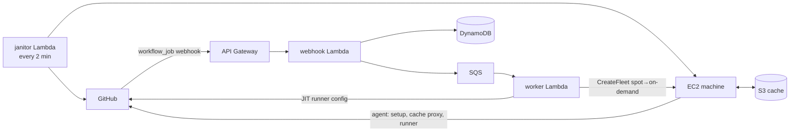

# truner

**Fast, cheap, ephemeral GitHub Actions runners in your own AWS account.**
One command to install. One label to use. Zero cost while idle.

[Website and documentation](https://truner.github.io/truner/) ·
[Getting started](https://truner.github.io/truner/getting-started) ·
[Releases](https://github.com/truner/truner/releases)

```yaml
jobs:
  build:
    runs-on: truner/cpu=4/run=${{ github.run_id }}   # was: ubuntu-latest
```

Every job gets a **fresh EC2 machine** that boots in seconds, runs exactly that
one job and disappears. You pay AWS prices (usually spot) per second, with no
per-minute markup, no runner VMs idling, and no Kubernetes cluster to babysit.

| | GitHub-hosted (larger runners) | truner |
|---|---|---|
| 4 vCPU Linux x64, per hour | ~$0.72 | ~$0.04 – $0.08 (spot) |
| Arm64, GPU, Windows, 192 vCPU | some, at premium prices | all, at EC2 prices |
| Cache | 10 GB per repo, egress-limited | unlimited S3, in-region, parallel |
| Your VPC, static IP, IAM role | no | yes |
| Idle cost | – | ~$0 (serverless control plane) |

*Prices are illustrative; `truner costs` shows your real numbers and savings.*

---

## Contents

- [Features](#features)
- [Quick start](#quick-start)
- [Choosing a machine](#choosing-a-machine)
- [How it works](#how-it-works)
- [The magic cache](#the-magic-cache)
- [Day-2 operations](#day-2-operations)
- [Costs](#costs)
- [Security](#security)
- [FAQ](#faq)
- Docs: [labels](docs/labels.md) · [configuration](docs/configuration.md) · [caching](docs/caching.md) · [images](docs/images.md) · [warm pools](docs/pools.md) · [networking & access](docs/networking.md) · [architecture](docs/architecture.md) · [troubleshooting](docs/troubleshooting.md)

## Features

**Launching**
- 🚀 **One ephemeral VM per job.** Clean environment every time; no cross-job leakage.
- 💸 **Spot first, on-demand fallback.** EC2 Fleet with `price-capacity-optimized` across
  *every* matching instance type and availability zone, so spot capacity is almost always found.
  If not, on-demand takes over automatically.
- 🎯 **Ask for resources, not instance types.** `cpu=8/ram=32` uses EC2 attribute-based
  selection to pick the cheapest suitable type, or pin `family=c7a+m7a` / `type=c7i.4xlarge`.
- 🧠 **x64, Arm64 (Graviton), NVIDIA GPUs and Windows Server (beta)** from the same label syntax.
- ⚡ **Warm pools** of stopped, pre-provisioned machines for ~10 second starts.
- 🧱 **Self-maintaining images.** truner bakes optimized AMIs the first time an image is
  used and rebuilds them weekly; until they are ready, jobs still run on the base image.
- 💽 **Local NVMe** instance storage is detected, striped (RAID 0) and used for the work
  directory and Docker automatically.

**Speed**
- 🪄 **Magic cache:** `actions/cache`, `setup-node`/`setup-python`/… caching and
  `docker buildx` `type=gha` transparently store in your S3 bucket. No workflow changes,
  no size limit, parallel downloads at hundreds of MB/s, no egress fees.
- 🐳 **Docker layer caching** via a ready-made ECR repository (`$TRUNER_ECR_CACHE`) or
  S3 (`type=s3`), with credentials already set up.
- 📦 **In-region runner mirror.** The 200 MB runner package comes from S3, not GitHub.

**Reliability**
- 🔁 **Self-healing.** Failed webhook deliveries are redelivered, jobs whose machine died
  before starting are relaunched, spot-interrupted jobs are re-run on on-demand
  capacity, and stuck machines are reaped.
- 🧯 **Readable failures.** A bad label or config fails the job with a clear message in the
  job log instead of leaving it queued forever.
- 🛑 **Guard rails.** Max concurrent instances, a hard monthly budget, budget alerts by
  email, per-job timeouts and idle shutdown.

**Operations**
- 🧾 **Cost tracking per job, repo and workflow**, compared with GitHub-hosted pricing
  (`truner costs`), plus a daily email report and cost allocation tags.
- 🩺 **`truner doctor`** checks credentials, stack, GitHub App, webhook deliveries, EC2
  quotas and recent failures, and tells you exactly what to fix.
- 🔭 **Observability:** CloudWatch dashboard, per-machine boot/agent logs, a summary
  banner at the top of every job log (machine, price class, boot time, cache).
- 🔐 **Debug access:** `truner connect <job>` (SSM, no open ports) or SSH with your GitHub
  keys, and `keep=30m` to inspect a machine after its job.
- 🧩 **Configuration as code:** repo-level `.github/truner.yml` and an account-wide config
  with reusable runner profiles, custom AMIs, pools and access rules.
- 🌐 **Networking:** dedicated VPC or your own subnets, optional NAT for a static egress IP.

## Quick start

You need an AWS account (administrator access for the install) and a GitHub
organization or personal account.

**1. Install the CLI**

```bash
# macOS / Linux
curl -fsSL https://raw.githubusercontent.com/truner/truner/main/install.sh | sh
```

```powershell
# Windows (PowerShell)
irm https://raw.githubusercontent.com/truner/truner/main/install.ps1 | iex
```

Or download a binary from the [releases page](https://github.com/truner/truner/releases).

**2. Install truner into your AWS account**

```bash
truner install
```

The installer walks you through everything:

1. **AWS credentials**: uses your existing profile or environment, or asks you to
   paste an access key (and can save it as a `truner` profile).
2. **Preflight**: availability zones and EC2 vCPU quotas.
3. **Control plane**: deploys a CloudFormation stack (about 3 minutes).
4. **GitHub App**: opens your browser to create a private GitHub App with one
   click, then to install it on the repositories you choose.
5. **Images**: starts building optimized Ubuntu images in the background.

**3. Use it**

```yaml
jobs:
  test:
    runs-on: truner/cpu=4/run=${{ github.run_id }}
    steps:
      - uses: actions/checkout@v4
      - uses: actions/setup-node@v4
        with: { node-version: 22, cache: npm }   # cached in your S3 bucket
      - run: npm ci && npm test
```

> **Why `run=${{ github.run_id }}`?** GitHub routes a job to *any* runner whose labels
> match. A unique token keeps machines from picking up jobs of other workflow runs.
> It is optional but recommended.

Check that everything works:

```bash
truner doctor
truner jobs --watch
```

## Choosing a machine

Labels are `key=value` pairs after the `truner` label, written either as a path or as a list:

```yaml
runs-on: truner/cpu=8/ram=32/run=${{ github.run_id }}
runs-on: [truner, cpu=8, ram=32, "run=${{ github.run_id }}"]
```

| Label | Example | Meaning |
|---|---|---|
| `runner` | `runner=16cpu-linux-arm64` | a named profile (built-in or from your config) |
| `cpu` | `cpu=4`, `cpu=4-16`, `cpu=8+` | vCPUs (exact, range, or minimum) |
| `ram` | `ram=16`, `ram=16-64` | memory in GiB (minimum unless a range) |
| `family` | `family=c7a+m7a`, `family=c8g` | instance families to choose from |
| `type` | `type=c7i.4xlarge+c6i.4xlarge` | exact instance types |
| `arch` | `arch=arm64` | `x64` (default) or `arm64` |
| `image` | `image=ubuntu24-full` | see [images](docs/images.md) |
| `spot` | `spot=false`, `spot=only` | default: spot with on-demand fallback |
| `disk` | `disk=200` | root volume GiB (gp3) |
| `disk-iops`, `disk-throughput` | `disk-iops=10000` | faster gp3 volumes |
| `nvme` | `nvme=true` | require local NVMe instance storage |
| `gpu` | `gpu=1` | NVIDIA GPUs |
| `private` | `private=true` | private subnets / static egress IP |
| `ssh` | `ssh=true` | install the triggering user's GitHub SSH keys |
| `keep` | `keep=30m` | keep the machine after the job for debugging |
| `timeout` | `timeout=3h` | hard limit for the machine's lifetime |
| `pool` | `pool=fast` | take a pre-warmed machine from a pool |
| `cache` | `cache=github` | use GitHub's cache instead of S3 (`off` to disable) |
| `run` | `run=${{ github.run_id }}` | uniqueness token (ignored) |

Built-in profiles: `{2,4,8,16,32,48,64,96}cpu-linux-{x64,arm64}`,
`{2,4,8,16,32,64}cpu-windows-x64`, `gpu-nvidia`, `gpu-nvidia-large`.
See exactly what a label resolves to, with live spot prices:

```console
$ truner explain truner/cpu=8/ram=32
Resolved: 8 vCPU / 32+ GiB linux x64, spot
  ...
Candidates: 41 instance types match in us-east-1; cheapest current spot prices:
  TYPE          SPOT (lowest AZ)
  m7a.2xlarge   $0.1312/h
  m6a.2xlarge   $0.1340/h
  ...
```

More examples:

```yaml
runs-on: truner/runner=8cpu-linux-arm64          # Graviton
runs-on: truner/cpu=32/ram=128/spot=false        # big and uninterruptible
runs-on: truner/image=ubuntu24-full/cpu=4        # GitHub-like toolset preinstalled
runs-on: truner/runner=gpu-nvidia                # NVIDIA GPU with drivers + Docker GPU support
runs-on: truner/runner=4cpu-windows-x64          # Windows Server 2025
runs-on: truner/cpu=16/nvme=true                 # local NVMe for I/O-heavy builds
runs-on: truner/pool=fast                        # warm pool, starts in seconds
```

Define reusable profiles in `.github/truner.yml`:

```yaml
runners:
  big:
    extends: 16cpu-linux-x64
    image: ubuntu24-full
    disk: 200
    env:
      GRADLE_OPTS: -Xmx24g
```

and use `runs-on: truner/runner=big`. See [configuration](docs/configuration.md).

## How it works



1. A job with a `truner` label is queued. GitHub sends a signed `workflow_job` webhook.
2. The **webhook** function verifies it, records the job and enqueues it.
3. The **worker** resolves labels and config into a machine spec, registers a single-use
   just-in-time runner with GitHub, and launches an instance with EC2 Fleet.
4. The **agent** on the instance prepares the machine (NVMe, Docker, software),
   starts the cache proxy and the runner. The runner takes the job, runs it, exits.
5. The machine powers itself off and is terminated. Its log is saved to S3.
6. The **janitor** heals everything in between: redelivers failed webhooks,
   relaunches jobs whose machine never started, re-runs spot-interrupted jobs,
   enforces deadlines, keeps pools full, bakes images and mirrors the runner.

Everything runs in **your** account. There is no truner service, no telemetry and no license key.
Details: [architecture](docs/architecture.md).

## The magic cache

On truner machines, `actions/cache` and everything built on it (`setup-node`,
`setup-python`, `setup-go`, `setup-java`, Gradle, `docker buildx` with
`type=gha`, …) store caches in **your** S3 bucket automatically:

- **No workflow changes.** It is the same protocol, served by a local proxy on each machine.
- **Unlimited size.** Entries expire after 10 days (configurable).
- **Fast.** In-region S3 through a free VPC endpoint, with parallel range downloads.
- **Branch isolation** like GitHub's: PRs read the base branch cache and write their own.
- **Works with old actions too** (`actions/cache@v3` uses the legacy protocol, which truner still speaks).

Every job log ends with a cache summary:
`truner magic cache: 3 hit(s), 1 miss(es), 1 save(s) · restored 1.4 GiB at 612.0 MiB/s`.

Docker layer caching:

```yaml
- uses: docker/build-push-action@v6
  with:
    cache-from: type=registry,ref=${{ env.TRUNER_ECR_CACHE }}:myapp
    cache-to: type=registry,ref=${{ env.TRUNER_ECR_CACHE }}:myapp,mode=max
```

See [caching](docs/caching.md) for S3 (`type=s3`) and `type=gha` setups.

## Day-2 operations

```bash
truner status                 # health, machines, queue, today's jobs and spend
truner doctor                 # end-to-end checks with fixes
truner jobs --watch           # live job list: machine, wait, duration, cost
truner costs --by workflow    # spend and savings vs GitHub-hosted
truner logs 123456789         # a job's machine log (boot, agent, runner)
truner logs --control-plane -f
truner connect 123456789      # shell into a job's machine (SSM)
truner explain truner/cpu=8   # what a label resolves to, with prices
truner images list|build      # optimized AMIs
truner cache ls|stats|purge   # the S3 cache
truner config edit            # account-wide config (profiles, pools, limits)
truner pools                  # warm pool status
truner quota --request 512    # raise EC2 vCPU quotas
truner upgrade                # update to this CLI's version
truner uninstall              # remove everything
```

Several independent installations can live side by side with `--stack` (for example
one per team, or one for untrusted repositories) and `--label-prefix`.

## Costs

- **Idle:** effectively $0. Lambda, SQS, DynamoDB (on-demand), API Gateway and S3 cost
  cents per month at low volume. Optional: NAT gateway (~$32/month) for a static IP.
- **Per job:** the EC2 price for the seconds the machine ran (60 s minimum) plus its
  disk. Spot is typically 60–90% below on-demand.
- **Images:** baked AMI snapshots, roughly $0.50–$2 per image per month.
- **Cache:** S3 storage for what you cache.

Set a hard budget and alerts:

```bash
truner install --alert-email ops@example.com --daily-report
truner config edit    # limits: { monthlyBudgetUsd: 500, maxInstances: 100 }
```

Machines carry `truner:repository`, `truner:workflow` and `truner:job-id` tags. Activate
them as cost allocation tags in the AWS Billing console for exact per-repo reporting.

## Security

- Each job runs on a **fresh VM** with a **single-use** runner registration, scoped to
  **one repository**. Nothing survives between jobs.
- The control plane verifies webhook signatures. The GitHub App's credentials live
  encrypted in SSM Parameter Store.
- Machines have no inbound access unless you enable SSH for a CIDR. Shells go through SSM.
- IAM is least-privilege: destructive EC2 actions only apply to resources tagged with
  your installation.
- All repositories using one installation share its cache bucket and machine role.
  Use separate installations (`--stack`) for different trust levels, and **do not** run
  untrusted fork pull requests on self-hosted runners.

Read [SECURITY.md](SECURITY.md) for the full model and how to report vulnerabilities.

## FAQ

**Which GitHub plans work?** Any github.com plan (Free, Team, Enterprise Cloud), for
organizations and personal accounts. Check GitHub's current pricing page for how
self-hosted runner usage is billed on your plan.

**GitHub Enterprise Server?** Not supported yet.

**macOS runners?** No. EC2 Mac instances need 24-hour dedicated hosts, which do not fit
the per-job model.

**How fast does a job start?** Typically 25–45 s on a baked image (EC2 boot dominates),
around 10 s from a warm pool, and longer on the first use of an image while it is
still being baked.

**What happens on a spot interruption?** If it happens before the job starts, truner
relaunches on on-demand capacity. If it happens during the job, GitHub marks the job
failed and truner re-runs it on on-demand capacity once the workflow run finishes
(disable with `retryOnInterruption: false`).

**Can jobs use AWS without secrets?** Yes. Attach policies to the runner role with
`truner install --runner-policy arn:aws:iam::aws:policy/...`. For production
deployments, prefer GitHub OIDC with a scoped role.

**Does it work with `container:` jobs and service containers?** Yes, Docker is
preinstalled. The magic cache works in container jobs too.

**How do I remove it?** `truner uninstall`. Then delete the GitHub App in your GitHub
settings (GitHub has no API for that).

## Development

```bash
go test ./...                    # unit tests
go run ./tools/build -targets host   # build the CLI with embedded agent and Lambda into dist/
```

See [CONTRIBUTING.md](CONTRIBUTING.md) for the integration test setup (DynamoDB Local,
the real `@actions/cache` toolkit) and the repository layout.

## License

[MIT](LICENSE)
