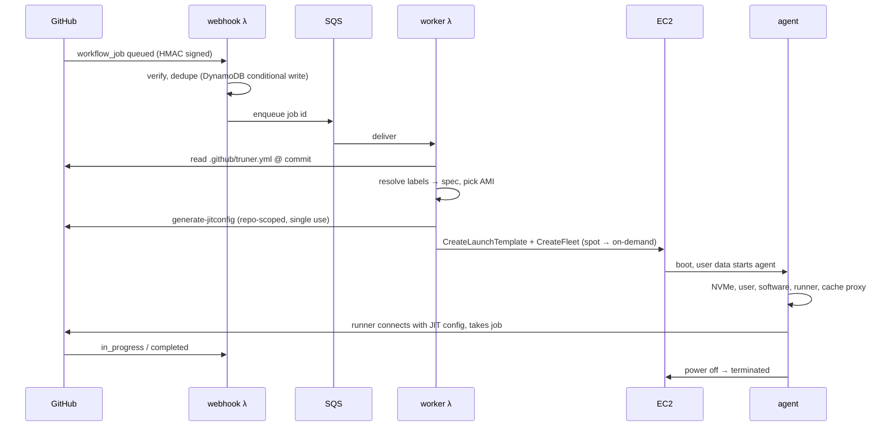

# Architecture

truner is two programs and a CloudFormation stack:

- **Control plane**: one Go binary deployed as three Lambda functions (webhook, worker,
  janitor) plus API Gateway, SQS, DynamoDB, S3, EventBridge and SNS.
- **Agent**: a Go binary that every runner machine downloads at boot (or finds in a
  baked image). It prepares the machine, serves the magic cache, runs the GitHub runner
  and powers the machine off.
- **CLI**: installs, upgrades and operates the stack. Release builds embed the Lambda
  package and agent binaries, so installing needs nothing else.

## Job lifecycle

## Components

**Webhook function** (API Gateway HTTP API → Lambda). Verifies `X-Hub-Signature-256`,
ignores jobs without a truner label, stores the job (idempotent by job id) and enqueues
it. Jobs whose labels look like truner's but carry another prefix (`truner/…` on a
`truner-acme` installation) are logged and kept for two days for `truner doctor`. On `in_progress` it records which machine took the job. On `completed` it computes the
job's cost from the machine's price and runtime, updates the monthly spend, and stops
machines whose job was cancelled before they picked it up.

The same function serves the GitHub App setup during `truner install`. The CLI
registers a pending setup with a random, single-use state, valid for an hour.
`/github/setup` posts the app manifest to GitHub. GitHub redirects to `/github/callback`,
where the code is exchanged for the app's credentials, which are stored in SSM. The
browser then continues to the app's installation page. Nothing has to run on the user's
machine during these steps, so the link can be opened on any device and an interrupted
install can continue.

**Worker function** (SQS → Lambda). Applies access rules, the instance limit and the
budget. Resolves the spec, claims a warm pool machine or resolves the AMI, registers a
just-in-time runner and launches with EC2 Fleet in `instant` mode. A per-job launch
template carries the user data and is deleted right after the launch. Capacity
problems are retried with backoff for about an hour. Unrecoverable configuration errors
launch a minimal machine that fails the job with the error message.

**Janitor function** (every 2 minutes, plus EC2 spot-interruption and state-change
events):
- terminates machines past their deadline or whose job ended
- relaunches jobs whose machine died before starting (on on-demand capacity)
- re-queues jobs stuck between webhook and worker
- redelivers failed webhook deliveries (via the GitHub App API)
- re-runs jobs killed by spot interruptions
- keeps warm pools at size and recycles stale pool machines
- drives image bakes (builder → AMI → prune old AMIs) and schedules rebuilds
- mirrors the latest `actions/runner` release into S3
- removes leaked launch templates
- sends the daily report

**State.** One DynamoDB table (on-demand billing): job records (90-day TTL), bake
state, spend counters, price and dedupe markers, plus a `byColl` index for per-day
queries. The data bucket holds the cache, logs, baked-image markers, the runner mirror
and the account config.

**Agent.** Started by user data (`systemd-run`), or on warm pool machines by a systemd unit:

1. Reads its config (gzip+base64 JSON in user data) and the instance metadata.
2. Stops apt timers, creates the `runner` user, sets up NVMe.
3. In parallel: installs the software profile (skipped on baked images) and
   downloads the runner (skipped when preinstalled at the right version).
4. Moves Docker onto NVMe, logs into ECR, installs SSH keys if requested.
5. Patches the runner for the magic cache and starts the cache proxy on port 28777.
6. Writes the runner's `.env`, the job hooks and the banner, and starts `run.sh --jitconfig`
   as `runner`.
7. Supervises it: idle timeout, maximum lifetime, spot interruption notices.
8. Optionally keeps the machine for debugging, uploads its log to S3 and powers off.

## Failure handling summary

| Failure | Handling |
|---|---|
| Webhook delivery failed (deploy, outage) | janitor redelivers through the GitHub API |
| Duplicate webhook | conditional write, enqueued once |
| No spot capacity | on-demand fallback in the same request cycle |
| No capacity at all / API throttling | retried with exponential backoff (≈1 h) |
| vCPU quota exhausted | retried, with an hourly email alert |
| Machine dies before taking the job | relaunched on on-demand capacity |
| Spot interruption during the job | job re-run on on-demand capacity after the run ends |
| Job cancelled while machine boots | machine terminated, runner deregistered |
| Jobs with equal labels swap machines | harmless when both machines come; costs are booked to the machine that ran each job |
| A job starts on another job's machine before its own launch (late `queued` event, or a launch waiting for capacity) | logged; the job left waiting gets a machine again once GitHub confirms it is still queued ([#3](https://github.com/codician-team/truner/issues/3)). The taken machine stays booked to the job that ran on it |
| Labels carry another installation's prefix | no machine; logged and reported by `truner doctor` |
| Agent crash | machine powers off. Deadline tag and janitor guarantee termination |
| Invalid label / config | job fails with the reason in its log |
| Budget reached | jobs wait in the queue, alert email sent |

## Cost of the control plane

At 1,000 jobs per day, monthly usage is about 100k Lambda invocations (mostly the
janitor), 60k DynamoDB writes, 30k SQS messages and 30k API Gateway requests. That is
cents to low dollars. The scheduled janitor (~22k invocations per month at ~200 ms) is the
largest fixed item, at around $0.10.
