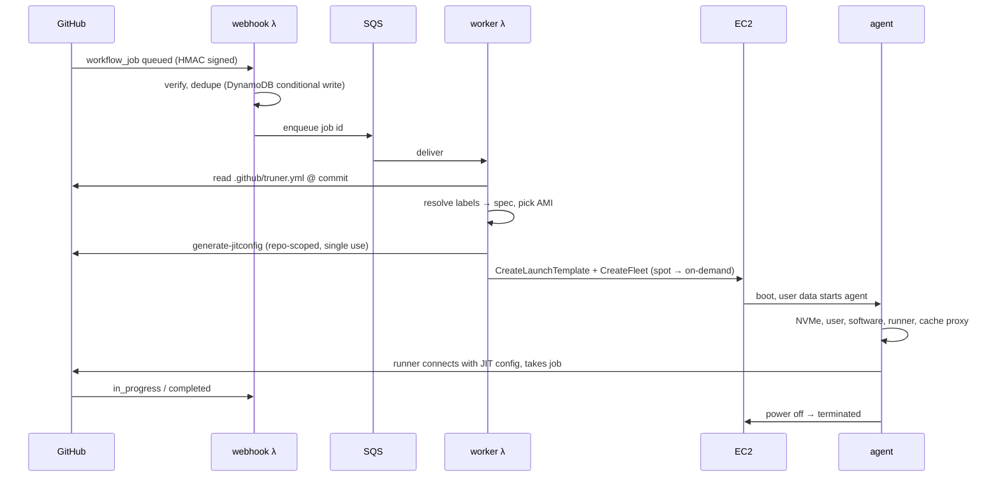

# Architecture

truner is three programs and a CloudFormation stack:

- **Control plane**: one Go binary deployed as three Lambda functions (webhook, worker,
  janitor) plus API Gateway, SQS, DynamoDB, S3, EventBridge, SNS and CloudWatch.
- **Agent**: a Go binary that every runner machine downloads at boot (or finds in a
  baked image). It prepares the machine, serves the magic cache and repository
  snapshots, runs the GitHub runner and powers the machine off. On a
  [MicroVM](microvms.md) it is part of the image and waits for a job.
- **CLI**: installs, upgrades and operates the stack. Release builds embed the Lambda
  package and agent binaries, so installing needs nothing else.

## Deployment

`truner install` and `truner upgrade` upload the Lambda package, the agent binaries and
the template to the bucket `truner-artifacts-<account>-<region>`, which all
installations in the region share, and create or update the stack. Every install and
upgrade sets a stack policy that denies every update, and lifts it for that update only
(`StackPolicyDuringUpdateBody`). Installations from before v0.1.5 get the policy with
their next upgrade. A CLI older than v0.1.5 does not lift it, so its update, which would
deploy its own older version, fails and rolls back. Before it deploys, the CLI updates
itself to the latest release (unless `--no-cli-update`) and refuses to deploy a version
older than the installation's without `--allow-downgrade`.

## Job lifecycle

A micro job takes the same path, except that the worker calls Lambda's `RunMicrovm`
with a MicroVM image instead of EC2 Fleet, and the webhook terminates the MicroVM when
the job completes.

## Components

**Webhook function** (API Gateway HTTP API → Lambda). Verifies `X-Hub-Signature-256`,
ignores jobs without a truner label, stores the job (idempotent by job id) and enqueues
it. Jobs whose labels look like truner's but carry another prefix (`truner/…` on a
`truner-acme` installation) are logged and kept for two days for `truner doctor`. On
`in_progress` it records which machine took the job. When a job started on a machine
launched for another job before one was launched for itself, it queues a check of the
repository's jobs for 30 seconds later (see [taken machines](#taken-machines)). On
`completed` it books the cost of the machine that ran the job (price and runtime, at
least 60 seconds, plus its disk) to that job, updates the monthly spend and sends the
budget alerts at 80% and 100%. It terminates the MicroVM of a micro job, stops machines
whose job was cancelled before they picked it up, and schedules a re-run of a job that a
spot interruption made fail. A failed handling returns HTTP 500, so the janitor
redelivers the event.

The same function serves the GitHub App setup during `truner install`. The CLI
registers a pending setup with a random, single-use state, valid for an hour.
`/github/setup` posts the app manifest to GitHub. GitHub redirects to `/github/callback`,
where the code is exchanged for the app's credentials, which are stored in SSM. The
browser then continues to the app's installation page. Nothing has to run on the user's
machine during these steps, so the link can be opened on any device and an interrupted
install can continue.

**Worker function** (SQS → Lambda). Applies access rules, the instance limit (EC2
machines and MicroVMs together) and the budget. Resolves the spec, starts a MicroVM for a
micro job, claims a warm pool machine or resolves the AMI, registers a just-in-time
runner and launches with EC2 Fleet in `instant` mode. A per-job launch template carries
the user data and is deleted right after the launch. Capacity problems are retried with
backoff (15 seconds, doubling up to 5 minutes) for up to 15 attempts, about an hour; then
the job fails and an alert is sent. Jobs held back by the instance limit or the budget
are retried every 30 seconds or 10 minutes without using up attempts. Unrecoverable
configuration errors launch a minimal machine that fails the job with the error message.
A micro job runs on an EC2 machine instead when no MicroVM can run it
([MicroVMs](microvms.md#how-it-works)). The worker also runs the checks for
[taken machines](#taken-machines). The queue hands a message to the worker up to five
times before it goes to the dead-letter queue.

**Janitor function** (every 2 minutes, plus EC2 spot-interruption and state-change
events). Each task runs on its own, so one failing does not stop the others:
- terminates machines past their deadline (`timeout` plus `keep` plus 30 minutes), and
  machines whose job ended more than `keep` plus 10 minutes ago
- relaunches a job whose machine stopped before taking it (after 90 seconds), or whose
  runner did not take it within 25 minutes (5 minutes on a MicroVM), once GitHub confirms
  that the job is still queued. The new machine is on-demand when the old one was a spot
  machine that stopped or got an interruption notice, and on EC2 when the old one was a
  MicroVM
- launches a machine again for a job whose machine another job took
  ([taken machines](#taken-machines))
- re-queues jobs stuck between webhook and worker (queued for 20 minutes, or launching
  for 10)
- ends MicroVMs whose job is over (after 2 minutes), whose job was cancelled or failed
  before it took one (after 5 minutes), or that no job knows about (after 15 minutes)
- redelivers failed webhook deliveries of the last 2 hours, at most 3 times each (via the
  GitHub App API)
- re-runs jobs killed by spot interruptions once their workflow run has finished
- keeps warm pools at size and recycles stale pool machines
- drives image bakes (builder → AMI → prune to the newest two AMIs) and schedules
  rebuilds (checked hourly)
- follows MicroVM image builds and deletes replaced image versions after 9 hours
- mirrors the latest `actions/runner` release into S3
- removes launch templates older than 30 minutes
- sends the daily report

**State.** One DynamoDB table (on-demand billing): job records (90-day TTL), machines
kept apart from their job (7 days), jobs with another installation's prefix (2 days),
bake and MicroVM image state, spend counters, price and dedupe markers, plus a `byColl`
index for per-day queries. The data bucket holds the cache and repository snapshots
(`cache/`, `docker/`, kept `--cache-days`), machine logs (`logs/`, kept `--log-days`),
baked-image and pool markers, MicroVM build contexts (30 days) and per-job MicroVM
configurations (1 day), the runner mirror and the account config. The control plane
logs to the CloudWatch log groups `/truner/<installation>/webhook`, `worker` and
`janitor`, and MicroVMs to `/truner/<installation>/microvms`, all kept `--log-days`.

**Agent.** On baked images and warm pool machines it starts from its own systemd unit as
soon as the network is up. On other images user data starts it (`systemd-run`), and on
baked images user data finds it running:

1. Reads its config (gzip+base64 JSON in user data) and the instance metadata.
2. Stops apt timers, creates the `runner` user, sets up NVMe.
3. In parallel: installs the software profile (skipped on baked images) and
   downloads the runner (skipped when preinstalled at the right version).
4. Moves Docker onto NVMe, logs into ECR, installs SSH keys if requested.
5. Patches the runner for the magic cache and starts the cache proxy on port 28777, which
   also serves [repository snapshots](caching.md#repository-snapshots). A `git` wrapper
   first on the runner's `PATH` asks it to restore a snapshot before `actions/checkout`
   fetches.
6. Writes the runner's `.env`, the job hooks and the banner, and starts `run.sh --jitconfig`
   as `runner`.
7. Supervises it: idle timeout, maximum lifetime, spot interruption notices. The
   job-completed hook prints the cache statistics and saves a repository snapshot when
   one is due.
8. Optionally keeps the machine for debugging, uploads its log to S3 and powers off.

On a MicroVM, the agent is the image's entrypoint. When Lambda builds the image, it
downloads the runner and reads its files into memory before Lambda takes the snapshot.
Each MicroVM resumes from that snapshot, and its run hook passes the job's runner
configuration (a pre-signed S3 URL, since the hook payload is too small for it). Jobs run
as root there.

### Taken machines

GitHub gives a job to any idle runner whose labels match, and truner registers each
machine with exactly its job's labels. Jobs with equal labels can therefore run on each
other's machines, which is harmless while every one gets a machine. When a job starts on
another job's machine before a machine was launched for itself (its `queued` event came
late, or its launch was waiting for capacity, the instance limit or the budget), one job
with those labels is left waiting.

The control plane then launches a machine again for the job left waiting: 30 seconds
after the webhook or the worker notices, through a queue message, and on every janitor
run. It does so only when GitHub confirms that the job is still queued and no spare
machine with the same labels (one still booting or idle whose own job started elsewhere)
can take it. The machine the job had keeps running the other job. Its record is kept
apart for 7 days under its runner name, so the other job's completion still books that
machine's cost to the job that ran on it and ends it. A run token per job
(`run=${{ github.run_id }}-<job>`) avoids all of this.

## Failure handling summary

| Failure | Handling |
|---|---|
| Webhook delivery failed (deploy, outage) | janitor redelivers through the GitHub API |
| Duplicate webhook | conditional write, enqueued once |
| No spot capacity | on-demand fallback in the same request cycle |
| No capacity at all / API throttling | retried with exponential backoff (≈1 h), then the job fails with an email alert |
| vCPU quota exhausted | retried every minute for up to 15 attempts, with an hourly email alert |
| Machine dies before taking the job | relaunched, on on-demand capacity if it was spot |
| Runner does not take the job within 25 minutes (5 on a MicroVM) | machine terminated, job relaunched |
| No MicroVM for a micro job (image building or failed, no quota, no MicroVMs in the region) | the job runs on an EC2 Graviton machine with the same vCPUs |
| Spot interruption during the job | if the job fails, it is re-run on on-demand capacity after the run ends (up to the third run attempt) |
| Job cancelled while machine boots | machine terminated, runner deregistered |
| Jobs with equal labels swap machines | harmless when both machines come; costs are booked to the machine that ran each job |
| A job starts on another job's machine before its own launch (late `queued` event, or a launch waiting for capacity, the instance limit or the budget) | logged; the job left waiting gets a machine again once GitHub confirms it is still queued ([#3](https://github.com/codician-team/truner/issues/3), see [taken machines](#taken-machines)). The taken machine stays booked to the job that ran on it |
| Labels carry another installation's prefix | no machine; logged and reported by `truner doctor` |
| Agent crash | machine powers off. Deadline tag and janitor guarantee termination |
| Invalid label / config | job fails with the reason in its log |
| Instance limit reached | jobs wait in the queue, retried every 30 seconds |
| Budget reached | jobs wait in the queue, retried every 10 minutes; alert emails at 80% and 100% |
| A CLI older than v0.1.5 updates the stack | denied by the stack policy; the update rolls back without changing anything |

## Cost of the control plane

At 1,000 jobs per day, monthly usage is about 100k Lambda invocations (mostly the
janitor), 60k DynamoDB writes, 30k SQS messages and 30k API Gateway requests. That is
cents to low dollars. The scheduled janitor (~22k invocations per month at ~200 ms) is the
largest fixed item, at around $0.10.
